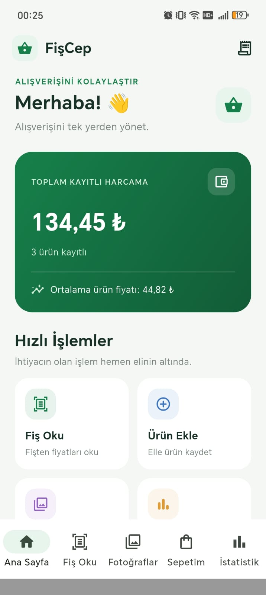
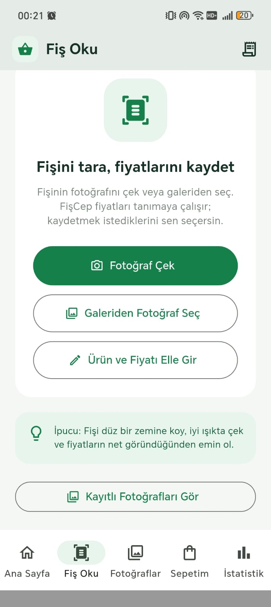
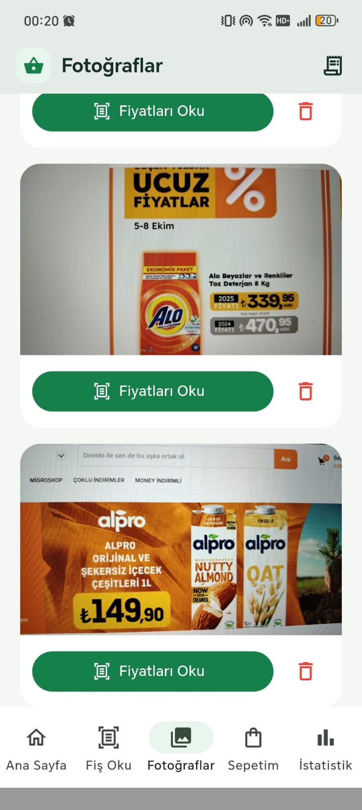
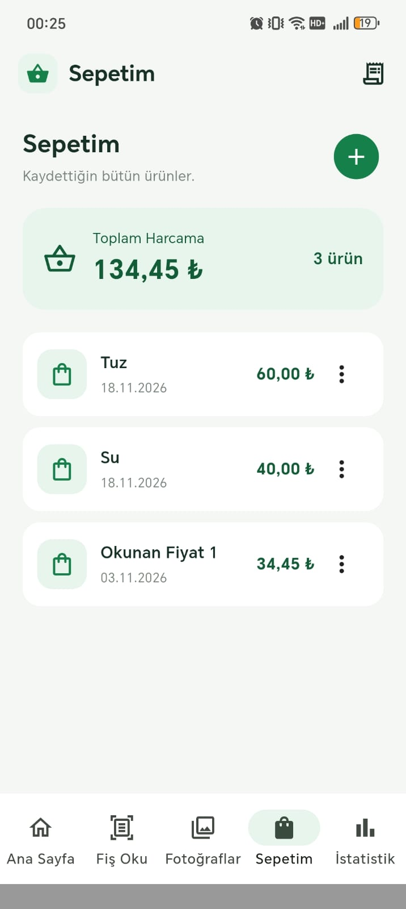
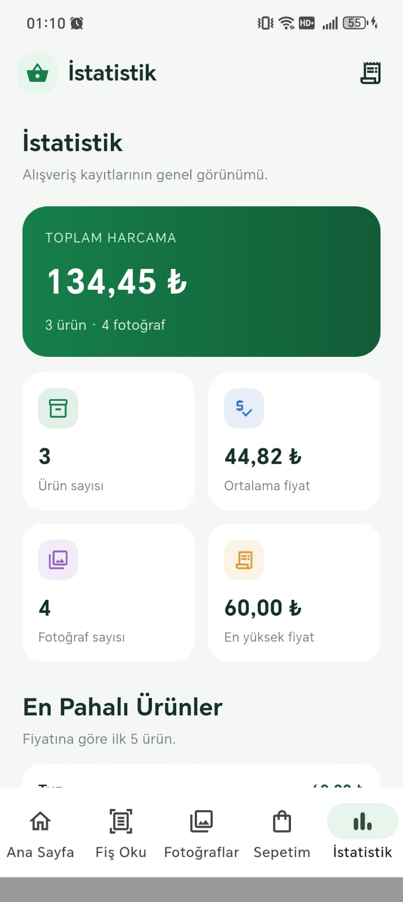

# FişCep | Shopping Expense Tracker

FişCep is a mobile app I developed to make tracking shopping expenses easier.

The idea behind the project is simple: scan a shopping receipt, recognize product prices using OCR, and keep track of expenses in one place.

### Features
- Scan shopping receipts and extract price information.
- Recognize text using Google ML Kit.
- Add or edit product prices manually.
- Save shopping records locally.
- View previously saved products and expenses.

### Built With
- Flutter & Dart
- SQLite
- Google ML Kit (OCR)

### About the Project
FişCep is a personal development project where I worked on mobile app development, database integration, and OCR-based text recognition.

**Status:** Developed as a personal project.  

---

### Screenshots

| Home Screen | Before Scanning |
|:---:|:---:|
|  |  |

| Receipt Photo | OCR Result 1 |
|:---:|:---:|
|  |  |

| OCR Result 2 | Product List |
|:---:|:---:|
|  |  |

### Expense Statistics

